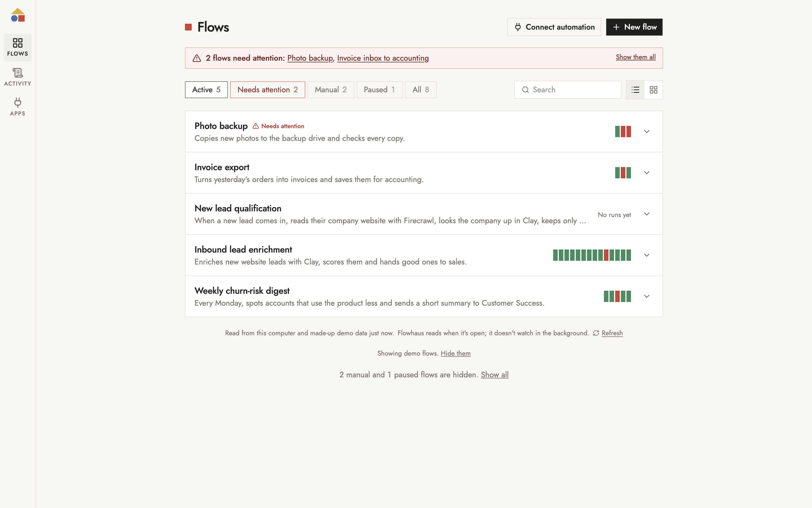
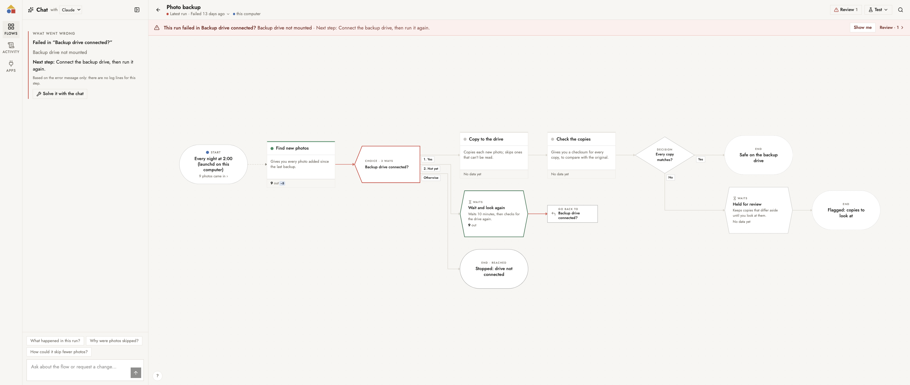

# Flowhaus

**See your automations as a plain-English map: what came in, what came out, what was skipped and why.**

> Status: early prototype (v0.2). Built-in support for **GitHub Actions** workflows and **scripts that write a folder per run**; anything else via a ~50-line Python adapter.



You already run automations: a GitHub Actions workflow that scrapes something every morning, a script that exports invoices, a backup job. When one of them goes quiet or half-fails, finding out *what happened* means reading logs. Flowhaus puts a map on top of them that a non-developer can read:

- **A flowchart of the stages**, written as outcomes ("Adds each page's text; skips pages that can't be fetched"):
  - a start and an end
  - decisions as diamonds with "Yes" / "No" paths, and choices with more answers
  - waits, and an end for every path
  - right-angle lines that don't cross

  Open a box to see the steps inside.
- **Numbers on every step** for each run: how many items went in, came out and were skipped, with the reasons ("286 merged as duplicates, 64 not a weekend outing").
- **What to do next, not just what's wrong.**
  - **When a run fails,** the chat opens with the problem to solve first, why that one, and a short next step ("Renew Xero's login, then run it again").
  - **The Review button** lists everything, in two tabs. **Errors:** the failed run, silent failures, drift over recent runs. **Improvements:** ideas from the numbers, and what's left to finish setting up. Each item has its next step and the log lines or numbers it's based on. The button turns red for a critical error (and so does **Run**), yellow for others, and shows a light bulb when there are only improvements.
- **Try before it's real** (the **Test** menu, all in test mode, sandboxed: [docs/testing.md](docs/testing.md)):
  - run one step on different input
  - replay a past run with today's steps and see which items would come out differently
  - pressure-test with many items in the test lab
  - **step through** a past run box by box
- **Failures that point somewhere**: the box that failed turns red, and the banner says why in plain words.
- **A chat panel**, running on Claude or Codex ([docs/codex.md](docs/codex.md)), that knows the run you're looking at and the code behind each step:
  - Ask "why did fewer events come through today?"
  - Ask it to fix things.
    - **Built flows:** Flowhaus checks the change itself by replaying the last run.
    - **Your automations:** it prepares the change on a private copy and shows the diff and what it affects downstream. The **pull request opens only when you click**. Critical points (P0) must be confirmed first; everything else is a suggestion.
- **Your own tools in the chat**: the MCP servers you already use with Claude Code, Claude Desktop, Cursor or Codex (n8n, databases, ...). See what each one offers on the Apps page. Switch them on, and each call asks you first ([docs/mcp.md](docs/mcp.md)).
- **A card overview** with the two numbers that matter per automation ("417 events published", "6 of 7 runs went fine").
- **An on/off switch** for GitHub workflows, if you allow it.

Think of it as a **harness for automations**. It maps them, reviews them, and helps change them safely. An automation is a chain: a small change in one step can reach every step after it. So:
- **Every change is reviewed for what it does downstream,** for repeated logic, and for log lines the map depends on.
- **Every point has a priority (P0 to P3),** and only critical ones hold the pull request back.
- **After it's merged,** it's measured against the numbers from before.

**From the runs, it flags what a careful reviewer would notice:**
- runs that fail, or look fine but produce less
- items vanishing without a reason
- a step that suddenly skips everything
- slow drift no single run shows
- the same kind of failure again and again
- missed schedules

The standard it holds automations to, and the writing conventions for maps (`flowhaus check --strict` enforces them in CI), are in [docs/practices.md](docs/practices.md).

Flowhaus never runs, deploys or edits your automations directly. It reads their logs and output folders, and code changes go through pull requests you approve.

**It is a local tool you open when you need it, not a hosted service.** Your automations keep running where they live (GitHub Actions, cron, a server); Flowhaus reads their history when you open it. It doesn't watch in the background or send alerts, and every page says when its data was read. It runs on `127.0.0.1` only. The only outside services it talks to are GitHub (through your `gh` login, to read runs) and Anthropic or OpenAI (only when you use the chat). It keeps no keys of its own; it reuses the logins and MCP setups already on your computer.



Flowhaus is made for a laptop or desktop browser. It works on a phone, but the map is easier to read on a bigger screen.

## Set it up with your coding agent

The quickest way is to let your agent do it. Open this repo in Claude Code, Codex, Cursor or similar, and say:

> Set up Flowhaus for my automations. Follow AGENTS.md.

[AGENTS.md](AGENTS.md) walks the agent through these steps:
1. install
2. find what you already run (`flowhaus scan`)
3. connect it (`flowhaus add`)
4. write the plain-English map
5. verify it against real runs (`flowhaus check`)

It asks you before anything sensitive.

## Set it up yourself

Prerequisites:
- [uv](https://docs.astral.sh/uv/) (it installs Python 3.12 for you)
- Node.js 20.19+ or 22.12+
- optional: the [GitHub CLI](https://cli.github.com), signed in with `gh auth login`, for GitHub Actions
- optional, for the chat: an `ANTHROPIC_API_KEY` or a [Claude Code](https://claude.com/claude-code) login, or the [Codex CLI](https://github.com/openai/codex) signed in with `codex login`

Install and check:

```bash
git clone https://github.com/Philthon/flowhaus && cd flowhaus
uv sync && npm --prefix web install
uv run flowhaus doctor
```

Connect a GitHub Actions workflow:

```bash
uv run flowhaus add github-actions my-scraper --repo you/scraper --workflow scrape.yml
```

Then edit `automations/my-scraper/automation.yaml`: plain-English labels and, optionally, counting rules from the log. See [docs/automations.md](docs/automations.md). Check the result and open the app:

```bash
uv run flowhaus check my-scraper
uv run flowhaus start          # → http://localhost:8765 (opens your browser)
```

## Using it day to day

`flowhaus start` runs one small local server in the background, with the API and the built UI on one port.
- Bookmark http://localhost:8765.
- If the bookmark doesn't load, Flowhaus isn't running; `uv run flowhaus start` brings it back.

| Command | What it does |
|---|---|
| `uv run flowhaus start` | start in the background and open the browser (reuses a running one) |
| `uv run flowhaus stop` | stop it |
| `uv run flowhaus status` | is it running, and where |
| `uv run flowhaus autostart on` | macOS: start it at login, so the bookmark always works |
| `uv run flowhaus autostart off` | undo that |

The server uses almost nothing while idle and only reads your automations when a page asks.

To look around first, use the examples, which work offline, or click **Explore demo flows** on the Flows page:

```bash
FLOWHAUS_AUTOMATIONS_DIR=examples/automations uv run flowhaus start
```

## How it works

```
automations/<id>/automation.yaml      ← your config (git-ignored): where runs live + the plain-English map
          │
server/automations/                   ← adapters turn runs into one shape: steps × (in, out, skipped + reasons)
  github_actions.py   (gh run list / run view --log, regex counting rules)
  folder_runs.py      (one folder per run, which files exist)
  python adapter      (yours)
          │
server/app.py  (FastAPI, 127.0.0.1)  →  web/  (React + React Flow)
server/insights.py, harness.py, review.py, nextstep.py, checkup.py   ← the harness: findings, next steps, the Review
server/agent.py  (the chat: Claude Agent SDK under your Claude Code setup, or Codex under your Codex setup)
```

Flowhaus also includes an experimental **builder**: the chat can create new flows from scratch (Python steps run with [Hamilton](https://github.com/apache/hamilton)), using demo Clay and Firecrawl connectors (made-up answers, no keys). These flows run locally when you press Run; every other run (tests, the chat's runs) runs in test mode, inside a sandbox with no network and no writes outside a scratch folder. The builder is off by default and only available with the demo flows turned on.

## Security

Flowhaus runs on your machine with your permissions, so read [SECURITY.md](SECURITY.md) before you use the chat or the builder. In short:
- **API:** answers only on localhost and refuses changes from other websites.
- **Chat:** runs under your own Claude Code setup (or your Codex setup): your permission rules decide what it may read, run or change without asking, and anything else shows an Allow / Deny card. Deny secrets and personal data there if they're within its reach.
- **Your automations:** never changed directly. Code changes go to a private copy and become a pull request only when you click, after you've confirmed any critical (P0) points.
- **Runs:** only **Run** is real. Tests, replays and the chat's runs are test-mode runs inside an operating-system sandbox. Real runs of built flows run as you, without your API keys in their environment.

## Development

```bash
uv run flowhaus dev                # API with reload on :8000 + Vite on :5173
uv run pytest -q                  # backend tests
npm --prefix web run build        # type check + build
npm --prefix web run lint
npm --prefix web test             # front-end unit tests
```

See [AGENTS.md](AGENTS.md#working-on-the-code) for a map of the code, and [CONTRIBUTING.md](CONTRIBUTING.md).

## License

MIT. See [LICENSE](LICENSE). Third-party notices are in [NOTICE.md](NOTICE.md). Changes are listed in [CHANGELOG.md](CHANGELOG.md). Please follow the [code of conduct](CODE_OF_CONDUCT.md).
